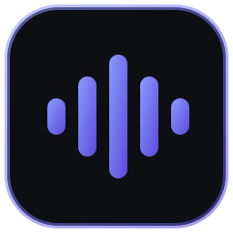
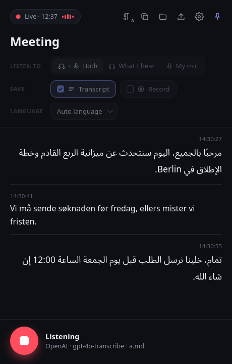
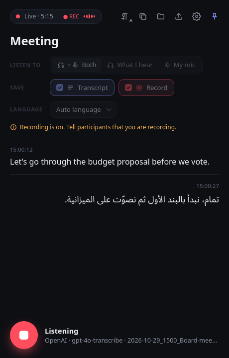
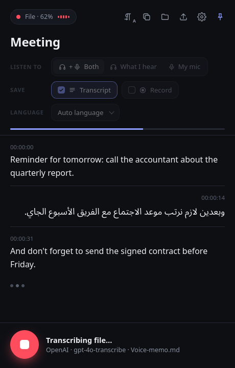
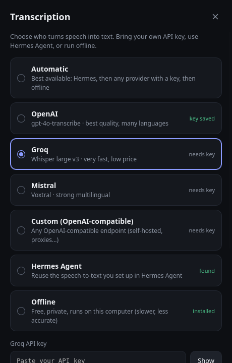

<p align="center">
  
</p>

<h1 align="center">Lisanote</h1>

<p align="center"><b>Live transcription of meetings, videos and your mic — in any language.</b><br>
Bring your own OpenAI / Groq / Mistral key, use Hermes Agent, or run fully offline.</p>

<p align="center">
  
  &nbsp;
  
  &nbsp;
  
</p>

<p align="center"><sub><b>Live transcription</b> — Arabic right-to-left, English and Norwegian left-to-right ·
<b>Transcript + Record</b> — the red ● REC badge shows the sound is being saved ·
<b>Audio files</b> — drop a phone voice memo to transcribe it</sub></p>

<p align="center">
  <br>
  <sub><b>Settings</b> — pick a provider and paste your own API key</sub>
</p>

<p align="center">🆕 <b>Lisanote 2.0</b>: record the sound and transcribe audio files — <a href="docs/WHATS-NEW.md">see what's new</a></p>

---

Live transcription of **everything you hear and say** — meetings (Zoom, Meet, Teams), videos,
lectures, any app — even with headphones on. Text appears in a small always-on-top window and is
saved as Markdown with timestamps. Arabic and other right-to-left languages are displayed correctly.

- 🎧 Captures system audio (what you hear) and/or your microphone
- 🔑 Bring your own key: **OpenAI**, **Groq**, **Mistral**, or any **OpenAI-compatible** endpoint
- 🤖 Or reuse the speech-to-text setup of [Hermes Agent](https://hermes-agent.nousresearch.com), or run **fully offline** (faster-whisper)
- ↔️ Per-line right-to-left / left-to-right (Arabic, Hebrew, Persian, Urdu… mixed with English)
- 🗂 Lives in the tray / menu bar, optional start at login
- 🐧 Linux and 🍎 macOS; 🪟 Windows experimental

## Download

Get the latest version from **[Releases](https://github.com/MartinDean07/lisanote/releases/latest)** — no building needed:

| System | File |
|---|---|
| 🐧 Linux (Ubuntu, Debian, Mint…) | `lisanote_<version>_all.deb` — double-click, or `sudo apt install ./lisanote_*.deb` |
| 🍎 macOS (Apple Silicon) | `Lisanote-<version>-macos-arm64.dmg` — drag to Applications; first start: right-click → **Open** |
| 🪟 Windows 10/11 (experimental) | `Lisanote-<version>-windows-setup.exe` — if SmartScreen warns: **More info → Run anyway** |

## Install from source

```sh
git clone https://github.com/MartinDean07/lisanote.git
cd lisanote
sh install.sh
```

Then open **Lisanote** from your app menu (Linux) or Launchpad / Spotlight (macOS).
On first start the **Settings** panel opens: pick a provider, paste your API key, press **Test & save**.

### Requirements
| | |
|---|---|
| Linux | `ffmpeg`, `pactl` (PipeWire or PulseAudio), and for the window/tray: `python3-gi gir1.2-webkit2-4.1 gir1.2-ayatanaappindicator3-0.1` (preinstalled on Mint/Ubuntu desktops) |
| macOS | `brew install ffmpeg blackhole-2ch` — see *macOS audio setup* below. `install.sh` adds `pystray` + `pywebview` |
| Windows | Python 3, then `py -m pip install soundcard numpy pystray pywebview pillow`; double-click `Lisanote.bat` |

### macOS audio setup (one time)
macOS cannot record "what you hear" by itself, so add the free BlackHole loopback driver:
1. `brew install blackhole-2ch` and log out/in once.
2. Open **Audio MIDI Setup** → `+` → **Create Multi-Output Device** → tick your headphones/speakers
   **and** BlackHole 2ch (headphones as primary, *Drift Correction* on BlackHole).
3. Select that Multi-Output Device as sound output while transcribing.
4. Allow **Microphone** access when asked.

Linux needs nothing extra: it records the monitor of your current output and follows you when you
switch to headphones or Bluetooth.

## Providers

| Provider | Default model | Get a key |
|---|---|---|
| OpenAI | `gpt-4o-transcribe` (also `gpt-4o-mini-transcribe`, `whisper-1`) | https://platform.openai.com/api-keys |
| Groq | `whisper-large-v3-turbo` | https://console.groq.com/keys |
| Mistral | `voxtral-mini-latest` | https://console.mistral.ai/api-keys |
| Custom | any model on an OpenAI-compatible `/v1/audio/transcriptions` endpoint (e.g. a self-hosted faster-whisper server) | — |
| Hermes Agent | whatever `stt.provider` you configured in Hermes | — |
| Offline | `faster-whisper` `small` on CPU (`pip install faster-whisper`) | free |

**Automatic** uses the provider you selected, otherwise Hermes Agent → any provider with a key → offline.

Keys can also come from environment variables: `OPENAI_API_KEY`, `GROQ_API_KEY`, `MISTRAL_API_KEY`,
`LISANOTE_API_KEY` (custom).

### Privacy
- API keys are stored **only on your computer** in `~/.config/lisanote/config.json`
  (`%APPDATA%\Lisanote\config.json` on Windows), with permissions `600`. The window only ever
  sees a masked version (`sk-…abcd`).
- Audio is cut into short pieces at natural pauses; silence is never sent. With a cloud provider
  those pieces go to that provider only. **Offline** keeps everything on your device.
- No audio is stored — only the text transcript.
- The app's local UI server listens on `127.0.0.1` only and requires a random per-run token.
- Recording other people may require their consent where you live.

## Using it
- **Record**: big round button or <kbd>Space</kbd>. Choose *Hear + mic*, *Hear only* or *Mic*, and a language (or auto).
- **Tray / menu bar**: closing the window keeps Lisanote running; the icon turns red while recording.
  Menu: Show · Start/Stop recording · Open transcripts folder · Start at login · Quit.
- **Save audio (off by default)**: choose *Text*, *Text + audio* or *Audio only* (no transcription, no API cost).
  The recording is **one `.m4a` file** next to the transcript with separate tracks:
  1 = everything mixed (what players play), 2 = what you hear, 3 = your microphone. It's written continuously,
  so a crash keeps what was recorded. Tell participants when you record. Not yet available on Windows.
- **Transcribe a file**: press the upload button or drop any audio/video file on the window (phone voice memos:
  m4a, mp3, wav, ogg/opus, amr, 3gp, mp4…). Timestamps are positions in the file.
- **Transcripts**: `~/Transcripts/<date>_<time>_<title>.md`, written live, one timestamped line per sentence.

### Command line
```sh
lisanote                               # what you hear + mic, provider from Settings
lisanote --source system --lang ar     # only other apps, Arabic
lisanote --engine groq --title "Lecture"
lisanote --set-key openai sk-...       # save a key without the UI
lisanote --save-audio                    # transcribe + keep the audio (.m4a, separate tracks)
lisanote --audio-only --title "Hearing"  # record only, no transcription
lisanote --file voice-memo.m4a           # transcribe an existing file
lisanote --stop
```

## How it works
`ffmpeg` (Linux/macOS) or WASAPI loopback (Windows) streams 16 kHz mono audio; Lisanote cuts it into
4–15 s chunks at pauses and sends each chunk to the chosen provider in a background thread. The window
is a small local web UI shown in a native web view (GTK/WebKit on Linux, pywebview on macOS/Windows,
or a Chrome/Edge app window as fallback).

Delay is roughly 5–20 s behind live speech, because each piece waits for a pause.

## Disclaimer

Lisanote is a tool. **You alone are responsible for how you use it.** Recording or transcribing
conversations, meetings, calls or media may be restricted by law where you live (for example consent,
privacy/GDPR, wiretapping or copyright rules). It is your responsibility to know and follow those rules and
to inform or get consent from the people involved. The author and contributors accept **no responsibility or
liability** for any use or misuse of this software, for recordings or transcripts made with it, or for any
damage, loss or legal consequences arising from its use. Transcriptions are produced by third-party or local
AI models and may contain errors; do not rely on them as an exact record without checking.
The software is provided "as is", without warranty of any kind (see [LICENSE](LICENSE)).

## License
MIT with an attribution requirement — free for personal and commercial use. If you use Lisanote
(or something built from it) commercially, credit the original author visibly, e.g.
*"Based on Lisanote by Martin Dean (https://github.com/MartinDean07/lisanote)"*.
See [LICENSE](LICENSE).
